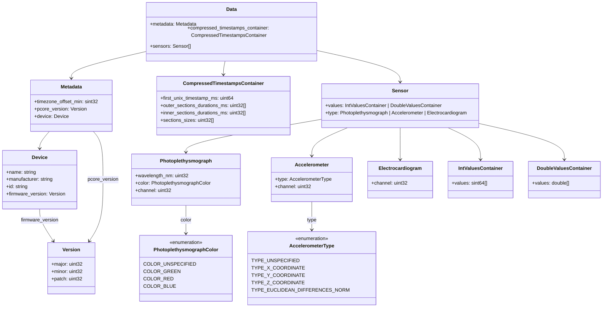

# pcore

## Documentation

This is a protobuf based file definition to save time based sensor data.

The basic ideas in the pcore format are

1. to get rid of timestamps as far as possible and
2. to store differences instead of absolute values of sensor data.

Currently, data from Photoplethysmograph (PPG), Accelerometer (ACC), and
Electrocardiogram (ECG) sensors are supported. Each sensor's data is stored in a
uniform Sensor structure, which encapsulates sensor-specific metadata and a sequence
of measurement values. Independent of the sensor type, the values are stored either as
integers (IntValuesContainer) or as floating-point numbers (DoubleValuesContainer).

All sensors of a Data message provide time-synchronized measurements. The underlying
timestamps are shared by all sensors and compressed using a structure called
CompressedTimestampsContainer. This container represents the measurement timeline by
dividing it into sections of constant time intervals. The compressed representation
stores the initial timestamp, the time deltas within a section, the time deltas
between the sections, and the number of data points per section.

For data compression purposes, measurement values are stored as follows:

- Integer values are stored as differences between consecutive values (deltas); the
  first value is stored as difference to zero.
- Floating-point values are stored as-is, without compression. They must be finite
  (no `NaN` or `Infinity`).

The compressed timestamps and values can later be reconstructed using the provided
decompression logic. This ensures both space-efficient storage and accurate recovery
of the original measurement series.

The structure of the compressed format is defined in the Data message. It includes
metadata, the compressed timestamps, and a list of sensor messages. For an overview of
the involved data structures and their relationships, refer to the class diagram below.

We recommend naming the resulting data files *.pcore (PreventicusCore).

The proto definition uses protobuf version 3.

## Scope and Constraints

- **One shared timeline per Data message.** All sensors of a `Data` message share a
  single `CompressedTimestampsContainer`, so every sensor holds exactly one value per
  timestamp. Sensors that are sampled at different rates (e.g. ACC at 25 Hz and PPG at
  100 Hz) or that are not sampled simultaneously must be stored in separate `Data`
  messages, i.e. in separate *.pcore files.
- **Timestamps** are Unix timestamps in milliseconds (UTC) and must be strictly
  increasing. `timezone_offset_min` describes the offset of the local time of the
  recording to UTC in minutes (e.g. 60 for UTC+01:00, -300 for UTC-05:00) and does not
  modify the stored timestamps.
- **Values** are stored as delivered by the device. The format does not define
  physical units or scaling of the values.
- **Accelerometer types.** `TYPE_X_COORDINATE`, `TYPE_Y_COORDINATE` and
  `TYPE_Z_COORDINATE` contain the acceleration along one axis.
  `TYPE_EUCLIDEAN_DIFFERENCES_NORM` contains the Euclidean norm of the differences of
  the x, y and z values (of the accelerometer with the same `channel`) to the previous
  timestamp, i.e. a measure of the movement between two timestamps:

  `value[i] = sqrt((x[i] - x[i-1])² + (y[i] - y[i-1])² + (z[i] - z[i-1])²)`

  As with the integer compression, the previous values of the first timestamp are 0,
  so `value[0] = sqrt(x[0]² + y[0]² + z[0]²)`.
- **PPG light.** The light of a `Photoplethysmograph` is described in one of two ways,
  depending on how the PPG is measured:
  - `color` for camera-based PPG, e.g. with a smartphone camera: the color channel
    (red, green or blue) of the RGB image sensor.
  - `wavelength_nm` for LED-based PPG sensors, e.g. in wearables: the wavelength of the
    LED in nanometers.

  These are different kinds of sensors. A green camera channel and a green LED with
  530 nm are therefore different sensors, even though both use green light.
- **Sensor identification.** A sensor is identified by its type message including all
  of its fields, not by its position in `sensors`:

  | Sensor type | identified by |
  |---|---|
  | `Photoplethysmograph` | light (`wavelength_nm` or `color`) and `channel` |
  | `Accelerometer` | `type` and `channel` |
  | `Electrocardiogram` | `channel` |

  Writers must set a sensor type (PPG, ACC or ECG) for every sensor and must make sure that no two sensors of a
  `Data` message have the same identification, e.g. two green PPG photodiodes get
  `channel` 0 and 1. The order of the sensors has no meaning; readers should look up
  sensors by their identification.
- **Files without channels.** The `channel` fields of `Photoplethysmograph` and
  `Accelerometer` were added later. Older files may therefore contain several sensors
  with the same identification (e.g. two green PPG sensors without channel). Readers
  must still accept such files and must keep the order of the sensors, because in these
  files the order is the only way to tell such sensors apart. For this reason the
  uniqueness is only checked when compressing.

## Protobuf Struct



## Compression

### Timestamp Compression

The basic idea behind compressing a sequence of unix timestamps is to group
all timestamps that have a constant interval between them into sections.

For each section, only the first timestamp needs to be stored in full under
first_unix_timestamp_ms. Since the time differences between consecutive
timestamps within a section are equal by definition, this interval stored in
inner_sections_durations_ms only needs to be stored once per section.
If a section contains only a single timestamp, its inner section duration
is defined to be 0.

Additionally, the number of timestamps in each section is stored in sections_sizes.

To reconstruct the full sequence, it is also necessary to store the duration between
the start of consecutive sections. This value—called the outer section duration—is
defined as the time difference between the first timestamp of section N+1 and the
first timestamp of section N. For the first section, the outer section duration is
defined to be 0.

One possible approach to grouping timestamps into sections is to iterate through
the array from left to right and check whether the time difference between consecutive
timestamps remains constant. If the difference changes, a new section is started
at that point.

The following algorithms demonstrate this approach. They expect the input to be
valid according to the [compression validation rules](#compression-1), in particular
the timestamps must be strictly increasing.

**Algorithm: FindSectionIndices**
<pre>
Name:
  FindSectionIndices

Input:
  unixTimestampsMs = [t₀, t₁, ..., tₙ]  // strictly increasing list of Unix timestamps

Output:
  SectionIdxs = [s₀, s₁, ..., sₘ] // indices in the Timestamps array where new sections start

Procedure:
  If unixTimestampsMs is empty:
    Return

  Append 0 to SectionIdxs
  Set isNewSection ← TRUE

  For i from 1 to length(unixTimestampsMs) - 1:
    Set duration ← unixTimestampsMs[i] - unixTimestampsMs[i - 1]

    If isNewSection:
      Set referenceDuration ← duration
      Set isNewSection ← FALSE

    If duration ≠ referenceDuration:
      Append i to SectionIdxs
      Set isNewSection ← TRUE

  Return SectionIdxs
</pre>

**Algorithm: CompressTimestamps**
<pre>
Name:
  CompressTimestamps

Input:
  unixTimestampsMs

Output:
  firstUnixTimestampMs
  innerSectionsDurationsMs
  outerSectionsDurationsMs
  sectionsSizes

Procedure:
  Set sectionIdxs ← FindSectionIndices(unixTimestampsMs)
  Set numberOfSections ← length(sectionIdxs)

  If numberOfSections == 0
    Return

  Set sizeUnixTimestamps ← length(unixTimestampsMs)
  Set firstUnixTimestampMs ← unixTimestampsMs[0]
  Append 0 to outerSectionsDurationsMs

  If numberOfSections == 1
    If sizeUnixTimestamps > 1
      Append unixTimestampsMs[1] - firstUnixTimestampMs to innerSectionsDurationsMs
    Else
      Append 0 to innerSectionsDurationsMs
    Append sizeUnixTimestamps to sectionsSizes
    Return

  Append unixTimestampsMs[1] - firstUnixTimestampMs to innerSectionsDurationsMs
  Append sectionIdxs[1] to sectionsSizes

  For i from 1 to numberOfSections - 2
    Set previousSectionIndex ← sectionIdxs[i - 1]
    Set currentSectionIndex ← sectionIdxs[i]
    Set nextSectionIndex ← sectionIdxs[i + 1]
    Append unixTimestampsMs[currentSectionIndex + 1] - unixTimestampsMs[currentSectionIndex] to innerSectionsDurationsMs
    Append unixTimestampsMs[currentSectionIndex] - unixTimestampsMs[previousSectionIndex] to outerSectionsDurationsMs
    Append nextSectionIndex - currentSectionIndex to sectionsSizes

  Set lastSectionIndex ← sectionIdxs[numberOfSections - 1]
  Append unixTimestampsMs[lastSectionIndex] - unixTimestampsMs[sectionIdxs[numberOfSections - 2]] to outerSectionsDurationsMs
  If sizeUnixTimestamps - 1 == lastSectionIndex:
    Append 0 to innerSectionsDurationsMs
  Else
    Append unixTimestampsMs[lastSectionIndex + 1] - unixTimestampsMs[lastSectionIndex] to innerSectionsDurationsMs
  Append sizeUnixTimestamps - lastSectionIndex to sectionsSizes
</pre>

Because a new section always takes over the following timestamp, only the last section
can consist of a single timestamp. Consequently, an inner section duration of 0 can only
occur in the last section.

### Integer Value Compression

To compress integer values in Protobuf, it is generally more efficient to
store smaller numbers. Therefore, the basic idea is to save the differences
between consecutive sensor data values. This approach is particularly effective
for sensor data that changes slowly over time. For the first value in the sequence,
the difference is defined as the difference between that value and zero.

<pre>
Name:
  CompressIntegerValues

Input:
  values // list of integers (IntValuesContainer.values)

Output:
  compressedValues

Procedure:
  If values is empty:
    Return

  Append values[0] to compressedValues
  For i from 1 to length(values) - 1:
    Append values[i] - values[i - 1] to compressedValues
</pre>

### Double Value Compression

Protobuf cannot further compress double-precision floating-point values.
Therefore, double values are stored as-is.

<pre>
Name:
  CompressDoubleValues

Input:
  values // list of doubles (DoubleValuesContainer.values)

Output:
  compressedValues

Procedure:
  If values is empty:
    Return

  For each value in values:
    Append value to compressedValues
</pre>

## Decompression

### Timestamp Decompression
<pre>
Name:
  DecompressTimestamps

Input:
  firstUnixTimestampMs
  outerSectionsDurationsMs
  innerSectionsDurationsMs
  sectionsSizes

Output:
  unixTimestampsMs

Procedure:
  Set currentTimestampMs ← firstUnixTimestampMs
  For i from 0 to length(sectionsSizes) - 1:
    Set currentTimestampMs ← currentTimestampMs + outerSectionsDurationsMs[i]
    For j from 0 to sectionsSizes[i] - 1:
      Append currentTimestampMs + j * innerSectionsDurationsMs[i] to unixTimestampsMs
</pre>

### Integer Value Decompression
<pre>
Name:
  DecompressIntegerValues

Input:
  compressedValues // list of differences (IntValuesContainer.values)

Output:
  values // list of integers

Procedure:
  If compressedValues is empty
    Return []

  Set cumulativeSum ← 0
  For each difference in compressedValues
    Set cumulativeSum ← cumulativeSum + difference
    Append cumulativeSum to values

  Return values
</pre>

### Double Value Decompression
<pre>
Name:
  DecompressDoubleValues

Input:
  compressedValues // list of doubles (DoubleValuesContainer.values)

Output:
  values // list of doubles

Procedure:
  For each value in compressedValues
    Append value to values
</pre>

## Validation

Two kinds of errors are distinguished:

- `InvalidDataException`: the data is structurally inconsistent (missing parts,
  mismatching lengths, timestamps that are not strictly increasing, ...).
- `WrongValueException`: a single value is outside of its allowed range.

The rules must be checked in the listed order.

**Arithmetic.** All calculations in the validation rules and in the compression and
decompression algorithms must be done with signed 64-bit integers (or wider) and must
not overflow. In particular, sums and products of `uint32` values such as
`sections_sizes` and `inner_sections_durations_ms` must not be calculated in 32 bit:
in 32 bit, `sections_sizes = [4294967295, 4]` would sum up to 3, so that a small,
manipulated file would pass rule 3 of the decompression and then request more than
4 billion timestamps. In languages without unsigned integers (e.g. Java, Kotlin),
`uint32` values of 2^31 and above appear as negative numbers and must be converted
first (e.g. with `Integer.toUnsignedLong`).

### Compression

Data is only allowed to be compressed if:

1. there is at least one unix timestamp and at least one sensor (`InvalidDataException`),
2. each sensor has the same number of elements as there are unix timestamps (`InvalidDataException`),
3. the unix timestamps are strictly increasing, i.e. there are no duplicates and no
   decreasing timestamps (`InvalidDataException`),
4. no unix timestamp is negative, because first_unix_timestamp_ms is a `uint64`
   (`WrongValueException`),
5. every resulting inner and outer section duration fits into `uint32`, i.e. is at
   most 4294967295 ms (`WrongValueException`),
6. every difference between consecutive integer values (and the first value itself)
   fits into a signed 64-bit integer (`WrongValueException`),
7. every double value is finite, i.e. not `NaN`, `Infinity` or `-Infinity`
   (`WrongValueException`),
8. timezone_offset_min is between -720 and 840 (`WrongValueException`),
9. every sensor has a sensor type set, i.e. one of photoplethysmograph, accelerometer
   or electrocardiogram (`InvalidDataException`). This does not refer to the
   `type` field of `Accelerometer`, which may be `TYPE_UNSPECIFIED`,
10. no two sensors have the same identification, see
    [Sensor identification](#scope-and-constraints) (`InvalidDataException`).

### Decompression

Data is only allowed to be decompressed if:

1. there is a compressed_timestamps_container with at least one section and at least one
   sensor (`InvalidDataException`),
2. outer_sections_durations_ms, inner_sections_durations_ms and sections_sizes
   have the same length (`InvalidDataException`),
3. each sensor has the same number of elements, and this number equals the sum of
   sections_sizes (`InvalidDataException`),
4. all elements of sections_sizes are greater than 0 (`InvalidDataException`),
5. the first element of outer_sections_durations_ms is 0 (`InvalidDataException`),
6. every other element of outer_sections_durations_ms is greater than the duration
   covered by the previous section, i.e.
   `outer_sections_durations_ms[i] > (sections_sizes[i-1] - 1) * inner_sections_durations_ms[i-1]`.
   This guarantees that sections do not overlap and that the decompressed timestamps
   are strictly increasing (`InvalidDataException`),
7. an element of inner_sections_durations_ms is 0 if and only if the corresponding
   section consists of a single timestamp (`sections_sizes[i] == 1`) (`InvalidDataException`),
8. every decompressed integer value fits into a signed 64-bit integer (`WrongValueException`),
9. every double value is finite, i.e. not `NaN`, `Infinity` or `-Infinity`
   (`WrongValueException`),
10. timezone_offset_min is between -720 and 840 (`WrongValueException`).

Whether a sensor type is set and whether the sensor identifications are unique is
intentionally not checked when decompressing, so that files written before the `channel`
fields existed can still be read (see [Files without channels](#scope-and-constraints)).

## Example

    (each | marks a timestamp; one character corresponds to 40 milliseconds, i.e. two |
    without space between them are 40 ms apart, two | with one space 80 ms, and so on)

      Section 1   Section 2 Section 3   Section 4
      ||||||||||  ||||||||  | | | | |   |||
    ──↑───────────↑─────────↑─↑──────────────────>
      a           b         c d               time

      a: first_unix_timestamp_ms (begin of measurement)
      c to d: inner_sections_durations_ms[2] (time difference within section 3)
      a to a: outer_sections_durations_ms[0] (always 0)
      a to b: outer_sections_durations_ms[1] (time difference to the start of the previous section)
      b to c: outer_sections_durations_ms[2] (and so on)


    unix,         ppg
    1675732789987,38763 <- Begin Section 1
    1675732790027,38771
    1675732790067,38780
    1675732790107,38793
    1675732790147,38784
    1675732790187,38780
    1675732790227,38780
    1675732790267,38783
    1675732790307,38790
    1675732790347,38782
    1675732790467,46321 <- Begin Section 2
    1675732790507,46327
    1675732790547,46318
    1675732790587,46316
    1675732790627,46313
    1675732790667,46313
    1675732790707,46313
    1675732790747,46336
    1675732790867,58772 <- Begin Section 3
    1675732790947,58774
    1675732791027,58775
    1675732791107,58776
    1675732791187,58773
    1675732791347,19982 <- Begin Section 4
    1675732791387,19982
    1675732791427,19978

    leads to the following Data message (protobuf text format, metadata omitted):

    compressed_timestamps_container {
      first_unix_timestamp_ms: 1675732789987
      outer_sections_durations_ms: [0, 480, 400, 480]
      inner_sections_durations_ms: [40, 40, 80, 40]
      sections_sizes: [10, 8, 5, 3]
    }
    sensors {
      int_values_container {
        values: [38763, 8, 9, 13, -9, -4, 0, 3, 7, -8, 7539, 6, -9, -2, -3, 0, 0, 23, 12436, 2, 1, 1, -3, -38791, 0, -4]
      }
      photoplethysmograph {
        color: COLOR_GREEN
      }
    }

## Test Specifications

The directory `unittest/` contains language-independent test cases as JSON files that
every implementation of pcore should reproduce:

- `unittest/compression/` – timestamp and value compression
- `unittest/decompression/` – timestamp and value decompression
- `unittest/validation/` – validation rules for compressing and decompressing

### File format

Each file contains a list of test cases:

```json
{
  "tests": [
    {
      "name": "TwoSectionTest",
      "operation": "compress_timestamps",
      "purpose": "Tests timestamps compression with two sections",
      "input": { "unix_timestamps": [1, 2, 3, 4, 6, 7, 8, 9] },
      "expected": {
        "first_unix_timestamp_ms": 1,
        "sections_sizes": [4, 4],
        "inner_sections_durations_ms": [1, 1],
        "outer_sections_durations_ms": [0, 5]
      }
    }
  ]
}
```

A test case either has `expected` (the expected output values) or `expected_error` (the
name of the expected exception, or `null` if the operation must succeed).

| operation | input | result |
|---|---|---|
| `compress_timestamps` | `unix_timestamps` | `expected`: `first_unix_timestamp_ms`, `outer_sections_durations_ms`, `inner_sections_durations_ms`, `sections_sizes` |
| `decompress_timestamps` | `first_unix_timestamp_ms`, `outer_sections_durations_ms`, `inner_sections_durations_ms`, `sections_sizes` | `expected`: `unix_timestamps` |
| `compress_int_values`, `compress_double_values` | `values` | `expected`: `compressed_values` |
| `decompress_int_values`, `decompress_double_values` | `compressed_values` | `expected`: `decompressed_values` |
| `compress_data` | `unix_timestamps`, sensors, `timezone_offset_min` | `expected_error` |
| `decompress_data` | `first_unix_timestamp_ms`, `outer_sections_durations_ms`, `inner_sections_durations_ms`, `sections_sizes`, sensors, `timezone_offset_min` | `expected_error` |

### Validation tests

- Each validation test targets exactly one validation rule; all other inputs are valid.
  Tests without timestamps naturally also have a mismatching number of values.
- Inputs that are not listed are absent (i.e. unset in the `Data` message).
- Sensors are given in one of two ways:
  - `int_values` / `double_values` each describe one sensor with these values and a type
    that is valid and unique within the test.
  - `sensors` lists the sensors explicitly. Each entry contains the sensor type as in the
    protobuf JSON mapping (`photoplethysmograph`, `accelerometer` or `electrocardiogram`;
    unset fields have their default value) and either `int_values` or `double_values`, e.g.
    `{"photoplethysmograph": {"color": "COLOR_GREEN", "channel": 1}, "int_values": [1, 2, 3]}`.
- In `decompress_data` tests the values are the compressed values as stored in the `Data`
  message.
- The rules for finite double values have no test case, because JSON cannot represent
  `NaN` and `Infinity`. Implementations should cover these rules with their own tests.

### 64-bit integers

All integers are JSON numbers, including the limits of `int64`, e.g.
`-9223372036854775808`. Each field always has the same JSON type in all test cases.

Integers outside of ±(2^53 − 1) (= ±9007199254740991) occur in a few validation tests.
They must be read exactly as 64-bit integers. Typed decoders usually do this when the
target type is a 64-bit integer (e.g. `Int64` in Swift, `Long` in Kotlin/Java). Parsers
that read every number as a double, such as `JSON.parse` in JavaScript, round these
values and need a parser that supports big integers.
